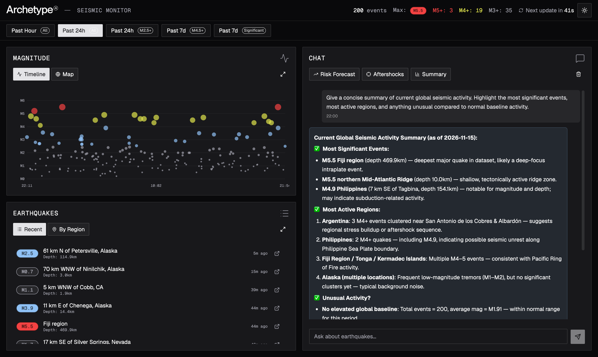

# Newton Seismic Monitor (Inference API)

Real-time earthquake monitoring dashboard powered by [Newton](https://www.archetypeai.io/) and the [USGS Earthquake Hazards Program](https://earthquake.usgs.gov/).

Newton analyzes live USGS earthquake data to identify patterns — aftershock sequences, regional clustering, and unusual seismic activity. Unlike the camera-based demos, this project showcases Newton's **text reasoning**.

This is the Inference API version of [archetypeai-earthquake-demo](https://github.com/archetypeai/archetypeai-earthquake-demo), which uses the Direct Query API. [MIGRATION.md](MIGRATION.md) explains what changed and compares the two.



## Features

- **Live earthquake feed** — real-time list from USGS, auto-refreshes every 60 seconds
- **Magnitude chart** — scatter plot of earthquake magnitudes over time, color-coded by severity
- **Feed filters** — switch between time ranges (1h, 24h, 7d) and magnitude thresholds (All, M2.5+, M4.5+, Significant)
- **Stats bar** — live event count, max magnitude, M5+/M4+/M3+ breakdowns
- **Newton chat** — ask Newton about current seismic activity with full earthquake data as context
- **Clickable events** — each earthquake links to its USGS event page

## Stack

- **SvelteKit** with Svelte 5 runes
- **Archetype AI Design System** — semantic tokens, component primitives, composite patterns
- **Geist and Geist Mono** — open-source fonts from `@fontsource-variable`
- **Newton Inference API** — Newton C 2.6 (`newton-c-2.6`) through the stateless query endpoint (`POST /api/inference/query`); no session
- **USGS GeoJSON Feeds** — real-time earthquake catalog, updated every minute
- **Tailwind v4** — styling with semantic design tokens

## Setup

Requires Node.js 20 or later:

```bash
git clone https://github.com/archetypeai/archetypeai-earthquake-demo-inference-api.git
cd archetypeai-earthquake-demo-inference-api
npm install
cp .env.example .env      # then add your API key
```

`.env` holds your Archetype AI API key and the production endpoint:

```
ATAI_API_KEY=your_api_key_here
ATAI_API_ENDPOINT=https://platform.u1.archetypeai.app
```

The `.env` file wins over any `ATAI_*` variables exported in your shell (see `vite.config.js`).

## Development

```bash
npm run dev
```

Open `http://localhost:5173`. Earthquake data loads automatically. Use the chat to ask Newton questions.

## How It Works

1. Server polls USGS GeoJSON feeds (updated every minute by USGS)
2. Earthquake data displays in a scrollable list and magnitude scatter chart
3. When you ask a question in chat, the server fetches fresh earthquake data, formats it as structured text, and sends it to Newton C 2.6 on the Inference API (`POST /api/inference/query`)
4. Newton analyzes the seismic data and responds with pattern analysis, risk assessment, or answers to specific questions

## Latency

Measured on production on 2026-11-14, with the three quick prompts and five example questions on three feeds (past day, past week, M4.5+ past week):

| | Time per answer | Median |
| --- | --- | --- |
| Example questions | 8–16 s | 11 s |
| Quick prompts (Risk Forecast, Aftershocks, Summary) | 10–23 s | 17 s |

The first query after a quiet spell can take 30–40 s longer while the model warms up.

## Known Limitations

- **Short answers.** The Inference API stops a query after about 58 seconds, so the prompt asks for answers under 300 words and caps them at 1,536 tokens. Longer, unbounded answers timed out.
- **Background rates.** Newton judges "normal" against its own idea of global earthquake rates, which is often wrong (for example, "10–20 M4+ earthquakes per month", when USGS estimates about 13,000 M4–4.9 earthquakes a year worldwide, or about 35 a day). The Direct Query version does the same. The magnitudes it quotes come from the data: 141 of 143 checked matched an event in the feed.

## Architecture

```
src/
├── routes/
│   ├── +page.svelte                  # Dashboard orchestrator
│   └── api/
│       ├── earthquakes/+server.js    # USGS feed proxy
│       └── analyze/+server.js        # Newton query
├── lib/
│   ├── server/
│   │   ├── usgs.js                   # USGS API client + data formatting
│   │   └── newton.js                 # Inference API client
│   ├── api/earthquakes.js            # Client-side fetch wrappers
│   └── components/ui/custom/
│       ├── earthquake-list.svelte    # Scrolling event list
│       ├── magnitude-chart.svelte    # SVG scatter chart
│       ├── chat-panel.svelte         # Newton Q&A
│       ├── feed-selector.svelte      # Time range / magnitude filter
│       └── stats-bar.svelte          # Live stats in menubar
```

## Example Questions for Newton

- "Are there any aftershock sequences in the current data?"
- "What regions have the most seismic activity right now?"
- "Is the current level of M4+ earthquakes normal for a 24-hour period?"
- "Summarize the strongest earthquakes and their potential impact"
- "Are any of these earthquakes near major population centers?"

## Licence

The code is licensed under the [Apache License 2.0](LICENSE). Earthquake data is fetched live from the [USGS Earthquake Hazards Program](https://earthquake.usgs.gov/) and is not part of this repository.
